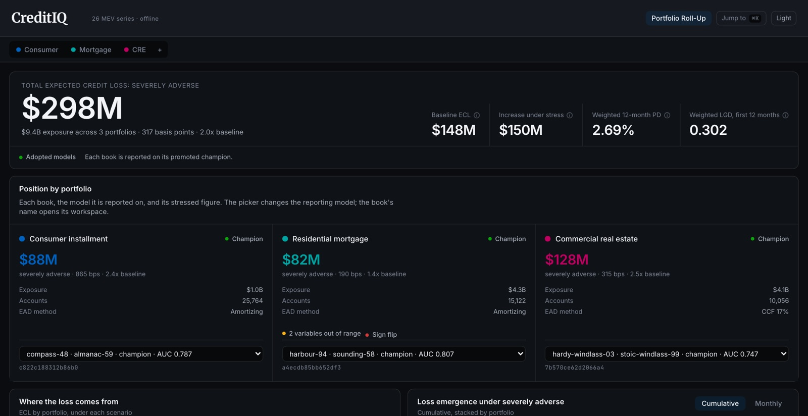
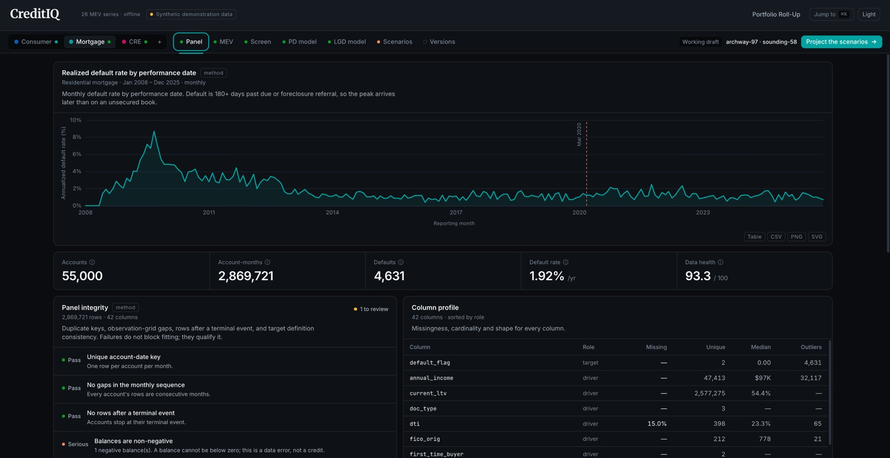
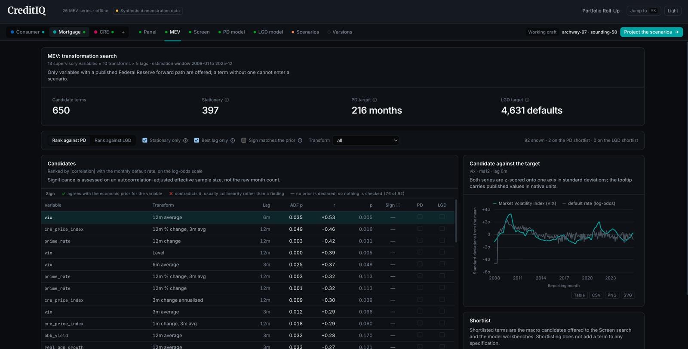
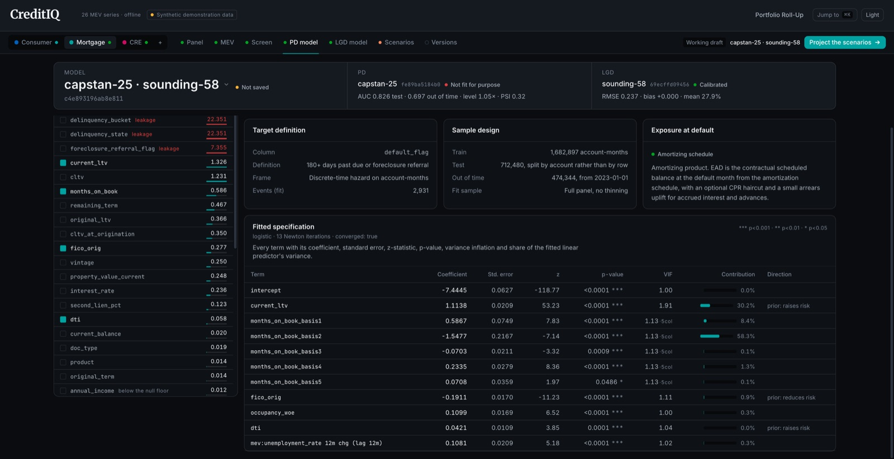
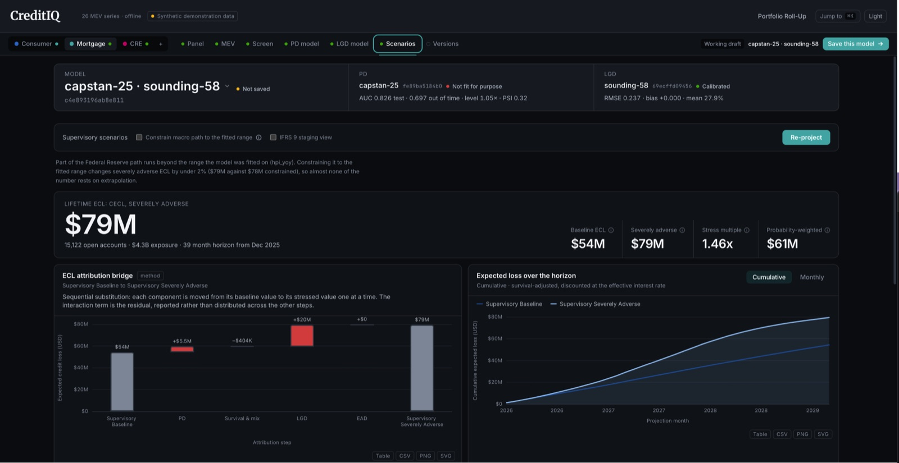
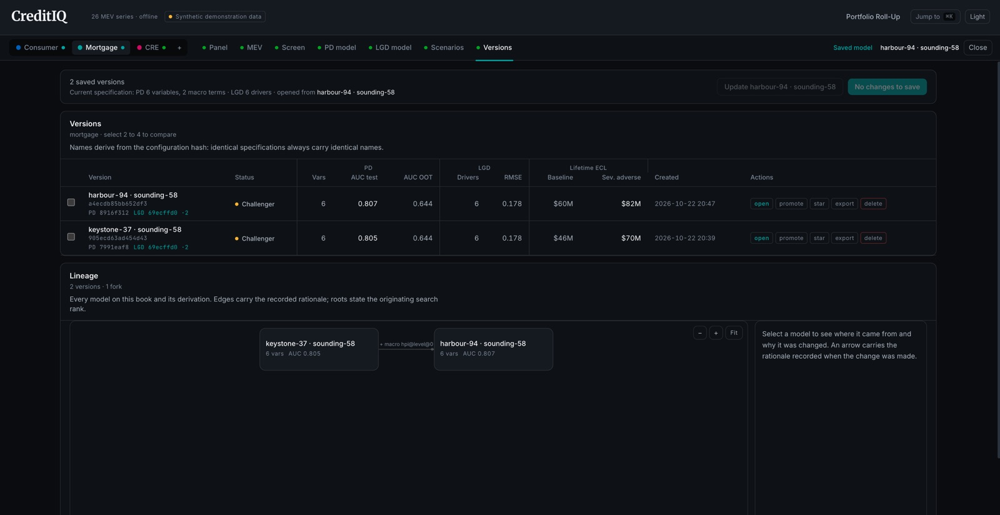

Welcome to my portfolio! I'm a credit risk modeler and product developer at KPMG, where I build and own analytics tools. My work sits at the intersection of finance, risk management and data science: leading model development teams, and designing the products that make that work faster.

(571) 271-2018 • [benuehlinger@gmail.com](mailto:benuehlinger@gmail.com) • McLean, VA

---

## **Education**

- **M.S. in Business Analytics**, William & Mary *(December 2024)* *4.00 GPA*
- **B.B.A in Finance**, James Madison University *(May 2021)* *3.61 GPA*

---

## **Work Experience**

**Modeling & Analytics Consultant @ KPMG US** *(June 2021 – Present)*  
- Manage two large staff augmentation workstreams within a large U.S. bank's quantitative office, leading teams of 12 and 7 that build models for the Credit Loss and Wholesale Risk Rating teams. The role calls for daily stakeholder engagement and hands-on technical expertise.
- Developed CECL C&I Probability of Default, Prepayment and UAD models for a midwest regional bank in DataBricks (Python), conducting daily coding workshops with the data science team to showcase progress.
- Validated CECL ensemble credit card model (PD, EAD, LGD), conducting sensitivity analyses, benchmarking, and stability tests for largest US credit union
- Designed GenAI risk-tiering framework and Retrieval Augmented Generation (RAG) model risk standard for a mid-sized midwest bank
- Led internal AI/ML model risk management research, resulting in at least three business opportunities and RFP wins
- Implemented parameter-efficient tuning (LoRA, QLoRA, DoRA) on DistilBERT models, presenting results to internal leadership in education sessions 
- Designed synthetic transaction testing for two machine learning models for a major tech client.
- Collaborate with multiple large banks throughout quarterly CECL accounting process to review entity's ongoing performance monitoring

---

## **Products Built at KPMG**

**ReserveIQ**  
- Built for financial due diligence (FDD) engagements where a lender needs a credit mark on a loan portfolio, which means building fast credit loss models on tight timelines. Much of that work repeats from deal to deal, so I turned it into a low-code tool.
- Built a Python/Streamlit reserve analytics app that ingests any bank's loan tape through schema-flexible column mapping. I chose Streamlit because the modeling team already works in Python, so analysts get a point-and-click interface on top of the same code without a separate front-end build.
- Fits panel logit PD (statsmodels) and LGD models and computes ECL = PD × LGD × balance.
- Stress-tests with Federal Reserve CCAR scenario paths joined to FRED macro history. The app then builds a PowerPoint deck (Plotly, python-pptx), with an LLM (gpt-oss-120b on Azure AI Foundry) drafting the chart narratives. The workflow cuts reserve analysis from 4 weeks to 4 days by eliminating most manual model-building hours, the main cost on FDD engagements.
- Presented firm-wide at an all-hands.
- Deployed as a Docker container on Azure Container Apps with Azure AD sign-in, per-user data separation and GitHub Actions CI/CD.

**CreditIQ**  
- Rebuilt ReserveIQ from a Streamlit prototype into a full model development workbench for consumer, mortgage and commercial real estate books.
- Moved the UI to React/TypeScript (Vite, Tailwind, ECharts, Zustand, TanStack Query) on a FastAPI backend, so heavy model fits run only when a user asks and switching views costs no compute.
- Every model is identified by a hash of its specification and data, making results cacheable and saved versions immutable and exactly reproducible.
- Automated variable selection, optimal binning, loan tape ingestion with validation, backtesting, and PD + LGD projection through 2026 Fed supervisory scenarios with FRED macro history. Backed by a backend test suite and browser tests.
- Presented to C-suite leaders at a national banking industry conference.
- Deployed as a Docker container on Azure Container Apps with Azure AD single sign-on, per-user data isolation and YAML-versioned configs.

<figure class="ciq-slide"><figcaption><strong>1/6 · Portfolio roll-up.</strong> Champion models across three books, stressed under the Fed severely adverse scenario.</figcaption></figure>
<figure class="ciq-slide"><figcaption><strong>2/6 · Panel.</strong> Realized default rates over time, with automated data integrity checks.</figcaption></figure>
<figure class="ciq-slide"><figcaption><strong>3/6 · Macro variable search.</strong> 650 candidate macro terms ranked against the default rate.</figcaption></figure>
<figure class="ciq-slide"><figcaption><strong>4/6 · PD model.</strong> Fitted specification with coefficients, standard errors, VIF and contribution.</figcaption></figure>
<figure class="ciq-slide"><figcaption><strong>5/6 · Scenarios.</strong> ECL attribution bridge and cumulative expected loss over the horizon.</figcaption></figure>
<figure class="ciq-slide"><figcaption><strong>6/6 · Versions.</strong> Saved models with reproducible IDs and a lineage graph.</figcaption></figure>

<button type="button" class="ciq-prev" aria-label="Previous">&#8249;</button>

<button type="button" class="ciq-next" aria-label="Next">&#8250;</button>

Screenshots use synthetic demonstration data. Click an image to open it full size.

**DecisionIQ**  
- Built an AI infrastructure decision-modeling tool for a major tech company with heavy AI investment exposure, helping leadership decide whether acquisitions are feasible and, if so, which targets make sense.
- Capacity model: projects AI capex commitments against ad revenue through free cash flow to M&A capacity, showing how much room the company has to act under each internal scenario.
- Contagion model: maps deals and dependencies across the AI ecosystem as a network graph (NetworkX) and scores each entity on opportunity and threat, flagging which targets strengthen the company's position and which carry spillover risk.
- Runs both models across scenario sweeps, replacing single-point forecasts with a quantified downside view on multibillion-dollar capex. Built in Python/Streamlit on Azure.
- Presented twice to the company's Chief Accounting Officer.

---

## **Personal and Educational Projects**

**Reverse-Engineering CMS Star Algorithm** *December 2024, William & Mary Capstone*  
- The CMS Star Rating quality metric from CMS that clusters hospitals into measure groups, and scores them on a scale of 1-to-5.
- Using publicly available information, our three-person team replicated the rating algorithm for 4,000+ hospitals, used machine learning to identify key measures, and simulated future star rating changes to deliver insights to our client, Riverside Hospital.
- The project is posted on [GitHub](https://github.com/benuehlinger/WM-Capstone).

**Low Rank Adaptation (LoRA) for Finetuning LLMs** *September 2024*  
- Performed research to understand how LoRA can make fine-tuning LLMs more efficient.
- The results are summarized in this [Medium post](https://medium.com/@benuehlinger/low-rank-adaptation-lora-for-fine-tuning-llms-2a04ba28b3a2), and the code is posted on [GitHub](https://github.com/benuehlinger/LoRA-finetune).

**COVID-19: A Black Swan?** *May 2021, James Madison Honors Capstone*  
- Applied Nassim Taleb’s tail-risk framework to assess the pandemic’s predictability and impact compared to other low-probability, high-impact events like 9/11 and the 2008 global financial crisis.  
- Performed cointegration tests and visually inspected returns of 11 SPDR Sector ETFs.
- [LinkedIn post](https://www.linkedin.com/posts/benuehlinger_covid-19-a-black-swan-activity-6805583797850005505-TC78?utm_source=share&utm_medium=member_desktop) with results.

---

Thank you for visiting my portfolio! I’m always looking to collaborate on interesting projects or discuss potential consulting opportunities. Let’s build something innovative together.

